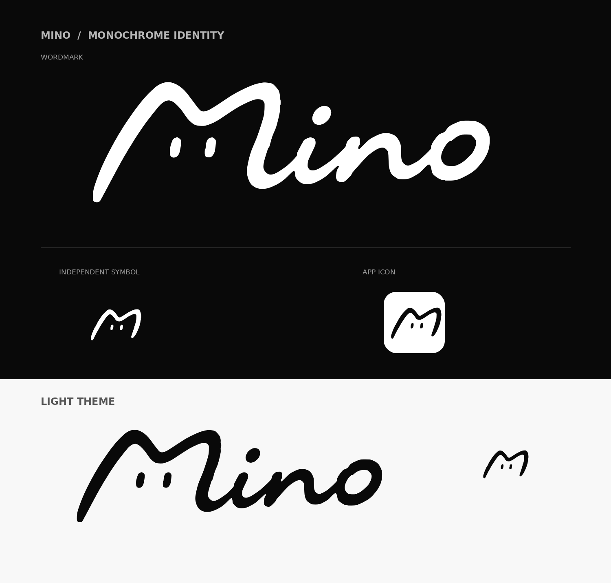

# Mino brand assets

[English](README.md) · [简体中文](README.zh.md)

The handwritten Mino wordmark and M symbol, without a star. SVGs use vector paths and require no fonts or external assets.

## Choose an asset

| Asset | Light background | Dark background | Use |
| --- | --- | --- | --- |
| Wordmark | [Black SVG](svg/mino-wordmark-black.svg) · [PNG](png/mino-wordmark-black.png) | [White SVG](svg/mino-wordmark-white.svg) · [PNG](png/mino-wordmark-white.png) | Headers, READMEs and covers |
| Symbol | [Black SVG](svg/mino-symbol-black.svg) · [PNG](png/mino-symbol-black.png) | [White SVG](svg/mino-symbol-white.svg) · [PNG](png/mino-symbol-white.png) | Standalone M with eyes |
| Avatar | [Light SVG](svg/mino-avatar-light.svg) · [PNG](png/mino-avatar-light.png) | [Dark SVG](svg/mino-avatar-dark.svg) · [PNG](png/mino-avatar-dark.png) | Square avatar with a built-in background |
| Small symbol | [Black SVG](svg/mino-favicon-black.svg) | [White SVG](svg/mino-favicon-white.svg) | M with eyes, matching the avatar |

## Favicons

Ready-to-use files with a built-in background: [SVG](favicon/favicon.svg), [ICO](favicon/favicon.ico), and PNGs at [32 px](favicon/favicon-32.png), [192 px](favicon/favicon-192.png) and [512 px](favicon/favicon-512.png).

## Usage

- Prefer SVG for websites and scalable artwork. PNG wordmarks are 1600 × 553; symbols and avatars are 1024 × 1024.
- Wordmarks and symbols have transparent backgrounds. Avatars and packaged favicons include their own backgrounds.
- Use black `#090909` on light surfaces and white `#FFFFFF` on dark surfaces. Keep the original proportions and leave clear space around the mark.
- Website asset URLs start with `/brand/`, for example `/brand/svg/mino-wordmark-white.svg`.

Source: `Mino-No-Star-Complete-Brand-Kit.zip`. Original hand-drawn contours are retained. Symbols, avatars, and favicons are centered and retain the eyes. `mino-moon.svg` is the separate website illustration.
