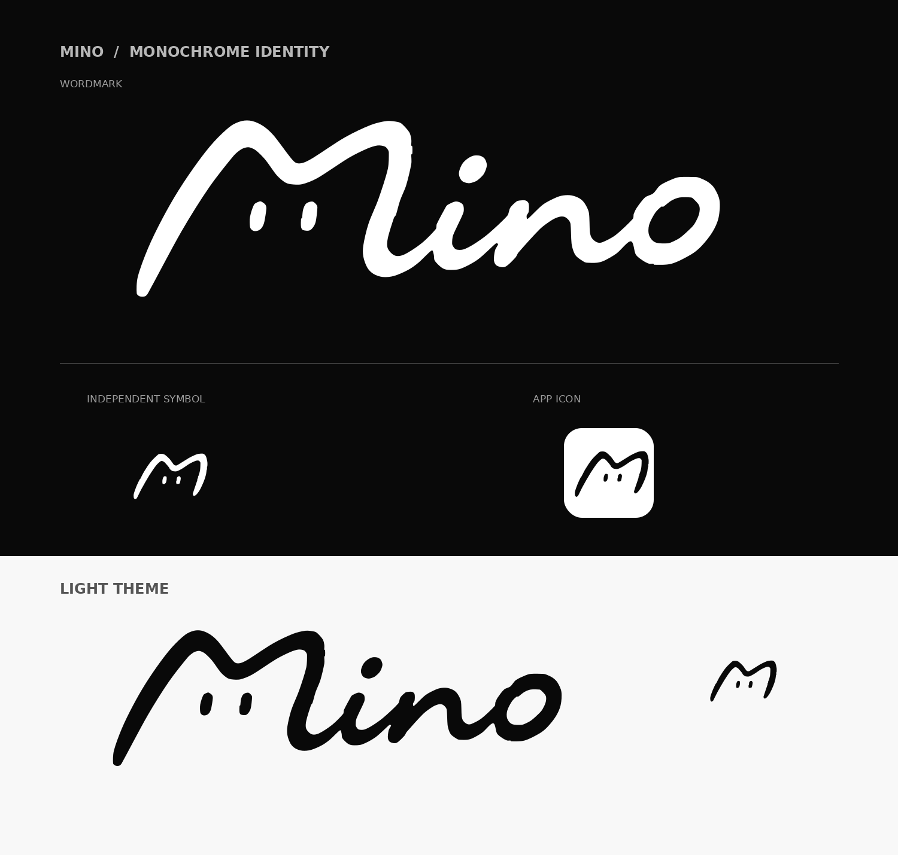

# Mino 品牌资源

[English](README.md) · [简体中文](README.zh.md)

无星星版手写字标与独立 M 图标。SVG 均为矢量路径，无需字体或外部资源。

## 选择资源

| 资源 | 浅色背景 | 深色背景 | 用途 |
| --- | --- | --- | --- |
| 完整字标 | [黑色 SVG](svg/mino-wordmark-black.svg) · [PNG](png/mino-wordmark-black.png) | [白色 SVG](svg/mino-wordmark-white.svg) · [PNG](png/mino-wordmark-white.png) | 网站页头、README、封面 |
| 独立图标 | [黑色 SVG](svg/mino-symbol-black.svg) · [PNG](png/mino-symbol-black.png) | [白色 SVG](svg/mino-symbol-white.svg) · [PNG](png/mino-symbol-white.png) | 带眼睛的独立 M |
| 方形头像 | [浅底 SVG](svg/mino-avatar-light.svg) · [PNG](png/mino-avatar-light.png) | [深底 SVG](svg/mino-avatar-dark.svg) · [PNG](png/mino-avatar-dark.png) | 自带背景的项目头像 |
| 小尺寸图标 | [黑色 SVG](svg/mino-favicon-black.svg) | [白色 SVG](svg/mino-favicon-white.svg) | 去掉眼睛的简化 M |

## 网站图标

自带背景，可直接使用：[SVG](favicon/favicon.svg)、[ICO](favicon/favicon.ico)，以及 [32 px](favicon/favicon-32.png)、[192 px](favicon/favicon-192.png)、[512 px](favicon/favicon-512.png) PNG。

## 使用约定

- 网站和缩放场景优先使用 SVG。PNG 字标为 1600 × 553，独立图标与头像为 1024 × 1024。
- 字标与独立图标为透明背景；头像和整套 favicon 自带背景。
- 浅色背景使用黑色 `#090909`，深色背景使用白色 `#FFFFFF`。保持原始比例，并在图形周围留出空白。
- 网站资源路径以 `/brand/` 开头，例如 `/brand/svg/mino-wordmark-white.svg`。

来源：`Mino-No-Star-Complete-Brand-Kit.zip`。原始图形与预览图保持不变。`mino-moon.svg` 为独立的网站插画。
